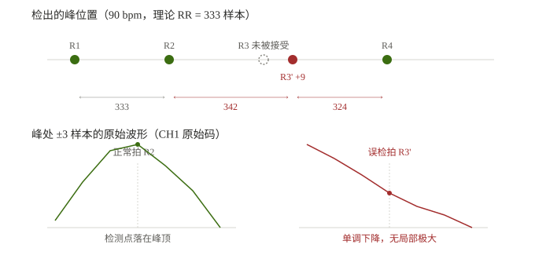

# T221 QRS 检测器缺陷：漏检 + 下降支误检（90 / 120 bpm）

> **日期**：2026-11-09　**场景**：真机态（STM32+ADS1293 → RS485 → ESP32），AECG100 固定心率
> **性质**：现象定位与证据链，**不含落码**。修法与验证计划见 §7。
> **前置**：UT-2211 已接 +5 V 供电（T220），上行坏帧率 2.3% → **0.000%**，下行 50% → **100%**
> **数据**：`esp32/485tools/hrv_data/`（18 轮 compact）+ `_wide_90bpm_v3.txt`（宽格式）

---

## 0 结论摘要

| 项 | 结论 | 证据强度 |
|---|---|---|
| 6 个心率中 4 个 PASS | 60 / 150 / 180 / 210，σ(e)=0.20~0.32 | **强**（18 轮） |
| 90 / 120 bpm FAIL | σ(e)=2.72 / 5.93，三轮一致 | **强**（各 3 轮） |
| 失效形态 | **单拍位置跳变**，成对 `+Δ / −Δ`，和恒等于 2×RR | **强**（观测事实） |
| 误检点波形 | **单调下降，无局部极大** | **强**（宽格式实测） |
| 根因是"R3 未被接受 + 下降支补检" | — | **中**（形态吻合，但未验证拒绝原因） |
| 90 与 120 同一机制 | — | **弱**（120 未做宽格式） |

---

## 1 现象：σ(e) 随心率非单调

| bpm | 理论 RR | σ(e) 三次 | 均值 | 定位跳变数 |
|---|---|---|---|---|
| 60 | 500.00 | 0.30 / 0.26 / 19.89\* | 0.28 | 0 / 0 / 4 |
| **90** | 333.33 | **2.66 / 3.06 / 2.43** | **2.72** | **48 / 65 / 40** |
| **120** | 250.00 | **5.53 / 5.83 / 6.43** | **5.93** | **28 / 32 / 38** |
| 150 | 200.00 | 0.20 / 0.22 / 0.22 | 0.21 | 0 / 0 / 0 |
| 180 | 166.67 | 0.32 / 0.32 / — | 0.32 | 0 / 0 |
| 210 | 142.86 | 0.23 / 0.23 / 0.24 | 0.24 | 0 / 0 / 0 |

\* 60 bpm 第 3 轮的 19.89 是局部误检，另两轮 0.26/0.30，判为偶发（疑 5V 接线瞬断，未取证）。

**量化极限**：整样本均匀量化 σ = 1/√12 = **0.289**。PASS 的四个心率都贴着这条线，说明检测器在那些工况下没有浪费精度。

### 1.1 排除了三个假设

| 假设 | 反例 | 结论 |
|---|---|---|
| 整数 RR 才准 | 120 bpm 的 RR=250.00（整数）却最差；180 bpm RR=166.67（分数）却好 | ❌ |
| 高心率退化 | 210 bpm 最高，σ=0.24 反而接近最好 | ❌ |
| 积分窗占比大导致 | 180 bpm 占比最高（窗/RR=36%）却好 | ❌ |

---

## 2 失效形态：成对跳变

90 bpm 的 RR 偏离理论值后，呈严格成对结构：

```
RR 序列（RR − 333）：
  ... +9×1, −8×1, 0×41, +9×1, −9×1, 0×9 ...
  ... +27×1, −27×1, 0×32 ...        ← 120 bpm 同构
```

`+Δ` 与 `−Δ` 紧邻 ⇒ **一次单拍位置跳变会产生两个异常间期**（跳变拍与其后一拍）。

**为什么之前的判据看不见**：脚本用 `|RR−T| > 0.75T`，而 342/333 = 1.027、324/333 = 0.972，**远未触发**。所以 18 轮报告里 90/120 一直写着"异常率 0.00%"。



---

## 3 关键证据：宽格式波形

`rpeak wide on` 后，每峰记录 ±3 个原始样本（CH1 原始码）。

### 3.1 正常拍

```
RR=333  v = 9049 → 9556 → 10013 → 10101 → 9810 → 9455 → 8974
                       上升 ────↑峰顶──── 下降
```

### 3.2 跳变拍

```
RR=342  v = 7751 → 7153 → 6452 → 5658 → 5106 → 4750 → 4394
              单调下降，每样本约 −550，没有任何局部极大
```

**判决**：该点不是 R 波峰顶。检测器在**下降支**上接受了一个峰。

### 3.3 位置说明（订正）

误检点位于真 R 峰后约 **9 个样本 = 18 ms**。

±3 样本窗口覆盖 ±6 ms，因此这 7 个点落在 **R 波下降支**上，**不是 T 波**（T 波在 R 后 150~250 ms）。
2026-11-09 17:30 初稿曾误写为"T 波下降支"，此处订正。

---

## 4 机制推断（**中等强度，未完全验证**）

代码里两道门都挡不住这种情况：

```c
/* ① 不应期：160 ms */
#define ECG_RP_REFRACTORY  80

/* ② T 波判别 */
const bool is_twave = (spacing < 360) && (rp->last_accepted_slope > 0.0f)
                      && (slope < rp->last_accepted_slope * 0.5f);
if (!is_twave && spacing >= ECG_RP_REFRACTORY) { accept_peak(...); }
```

失败的路径推测为：

```
第 k 拍：真 R 的 slope 偏小（< 前峰一半）
        ⇒ 被 is_twave 判为"T 波" ⇒ 拒绝
        ⇒ last_peak 仍停在第 k−1 拍
第 k 拍 +9 样本：下降支上积分峰再次超阈值
        ⇒ spacing = 342（相对 k−1），远大于不应期 80 ⇒ 放行
        ⇒ locate_rpeak 在滤波域找到极值 ⇒ 接受
```

**两道门都失效的原因**：

| 门 | 为什么失效 |
|---|---|
| 不应期 | `spacing` 是相对**上一个被接受的峰**算的，不是相对本拍真 R。漏一拍后参考点退到更早，误检点"合法" |
| T 波判别 | 拒绝真 R 之后，`last_accepted_slope` 未更新为"本拍"值，下一个候选的比较基准错位 |

**未验证的部分**：第 k 拍是否真的因 `is_twave` 被拒（需要打印 `slope` 与 `last_accepted_slope` 实测值）。

---

## 5 为什么滤波域选它、原始域却不是峰

`locate_rpeak()` 在 `integrated_peak ± 40` 窗口内找 **|滤波值| 的最大点**：

```c
for (int k = 0; k < rp->filt_n; k++) {
    const float a = fabsf(h->value);
    if (!found || a > best_abs) { best_idx = h->index; }
}
```

滤波链是一阶低通（A=0.25）+ 一阶高通（A=0.05），在下降支会产生极值 ⇒ 滤波域看似"合格"。

但在原始样本域，它是单调下降 ⇒ **根本不是峰**。

⇒ **判据必须回到原始样本**。

---

## 6 修法建议（待验证）

### 6.1 首选：原始域局部极大验证

在 `accept_peak` 之前加：

```c
/* 原始样本历史里，检测点必须是 ±1 邻域内的极大值 */
if (!(raw[peak] >= raw[peak-1] && raw[peak] >= raw[peak+1])) {
    /* 不是 R 波峰顶，按噪声处理 */
    rp->noise_peak = 0.125f * prev_integ + 0.875f * rp->noise_peak;
    return;
}
```

需要注意：`ecg_rpeak.c` 里目前只有 `filt_hist`（滤波值），要另加一份原始样本历史（约 40 行）。

| 优点 | 风险 |
|---|---|
| 不依赖阈值，不会引入新的幅度误判 | 若真 R 峰在某拍很平（低幅），可能被一并拒绝 |
| 不依赖心率，全范围同一套逻辑 | 需要额外 ~2 KB 内存（512×4B） |
| 物理意义明确：R 波必是尖峰 | — |

### 6.2 备选/补充

| 方案 | 说明 | 副作用 |
|---|---|---|
| 修 `is_twave` 判据 | 拒绝后应把 `last_peak` 标为"本拍已占用"，避免下降支补位 | 需重新验证全部心率 |
| 加"下降支拒绝" | 检测点若落在 `filt_hist` 的单调下降段则拒绝 | 与 6.1 重叠 |
| 调不应期 | **无效**——本例间距 342 远大于任何合理不应期 | 会误杀高心率真峰 |

### 6.3 不要做的事

- 🛑 **不要调 `ECG_RP_REFRACTORY`**：本例的误检点间距 342 样本（684 ms），远大于 160 ms 不应期，调它只会误杀 210 bpm 的真峰（RR=143 样本）。
- 🛑 **不要只改 `is_twave` 的 `spacing` 阈值**：90 bpm 的 RR 就是 333，任何围绕 360 的调整都会同时影响真峰判定。

---

## 7 验证计划（可证伪设计）

| # | 动作 | 通过标准 | 若失败说明 |
|---|---|---|---|
| **V1** | 加原始域局部极大验证，重测 90 bpm 3 次 | σ(e) ≤ 0.5 | **机制判断错**，需重新定位 |
| **V2** | 重测 120 bpm 3 次 | σ(e) ≤ 0.5 | 120 是另一种机制，需单独处理 |
| **V3** | 重测四个 PASS 心率各 1 次 | 不劣化（仍 ≤0.35） | 判据误杀了真峰 |
| **V4** | 补 120 bpm 宽格式一次（**改码前**） | 确认是否同为下降支误检 | 若是别的形态 ⇒ 修法要分两套 |

**V4 建议在改码前做**——成本 10 分钟，能避免"按一种机制改完发现要处理两种"。

---

## 8 已知缺口

| # | 缺口 | 影响 |
|---|---|---|
| 1 | 120 bpm 未做宽格式 | "同一机制"只是推断 |
| 2 | 未打印 `slope` / `last_accepted_slope` | "是否为 T 波判别误杀"未取证 |
| 3 | 60 bpm 第 3 轮的 3 次多检未查 | 可能是同源缺陷，也可能是 5V 瞬断 |
| 4 | 180 bpm 缺 1 次（第 15 轮 dump 失败） | 已有 2 次一致，影响小 |
| 5 | 数据全部来自 AECG100 固定心率 | 真实人体的心律不齐未覆盖 |

---

## 9 变更记录

| 版本 | 日期 | 变更 |
|---|---|---|
| v0.1 | 2026-11-09 | 立稿：18 轮数据、宽格式证据、机制推断、可证伪验证计划 |
