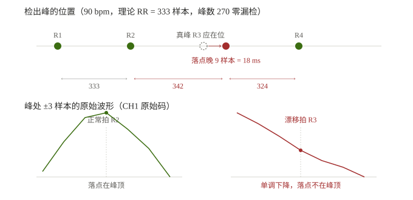

# T221 QRS 检测器缺陷：三类失效的定位（90/120 落点漂移 · 60 偶发多检）

> **日期**：2026-11-09　**场景**：真机态（STM32+ADS1293 → RS485 → ESP32），AECG100 固定心率
> **性质**：现象定位与证据链，**不含落码**。修法与验证计划见 §7。
> **前置**：UT-2211 已接 +5 V 供电（T220），上行坏帧率 2.3% → **0.000%**，下行 50% → **100%**
> **数据**：`esp32/485tools/hrv_data/`（18 轮 compact）+ `_wide_90bpm_v3.txt`（宽格式）

---

## 0 结论摘要

| 项 | 结论 | 证据强度 |
|---|---|---|
| 6 个心率中 4 个 PASS | 60 / 150 / 180 / 210，σ(e)=0.20~0.32 | **强**（18 轮） |
| 90 / 120 bpm FAIL | σ(e)=2.72 / 5.93，三轮一致 | **强**（各 3 轮） |
| 失效形态 | **单拍落点漂移**，成对 `+Δ / −Δ`，和恒等于 2×RR | **强**（观测事实） |
| **峰数准确**，无多检/漏检 | 90:270峰/179.35s=90.4bpm；120:360峰/179.5s=120.3bpm | **强**（反算心率对得上） |
| 漂移点波形 | **单调下降，无局部极大** | **强**（宽格式实测） |
| 漂移量 | 90 bpm **9 样本=18 ms**；120 bpm **27 样本=54 ms** | **强** |
| 根因是 `locate_rpeak` 选错极值（正/负/斜坡都算） | — | **中**（形态吻合，机理未直接取证） |
| **60 bpm 另有第三类失效：偶发多检** | 3 轮里 1 轮出现（181 峰，含 2 假峰 + 1 漏检） | **强**（宽格式实测，见 §3.4） |
| 90 与 120 同一机制 | — | **弱**（120 未做宽格式） |

---

## 1 现象：σ(e) 随心率非单调

| bpm | 理论 RR | σ(e) 三次 | 均值 | 定位跳变数 |
|---|---|---|---|---|
| 60 | 500.00 | 0.30 / 0.26 / 19.89\* | 0.28 | 0 / 0 / 4 |
| **90** | 333.33 | **2.66 / 3.06 / 2.43** | **2.72** | **48 / 65 / 40** |
| **120** | 250.00 | **5.53 / 5.83 / 6.43** | **5.93** | **28 / 32 / 38** |
| 150 | 200.00 | 0.20 / 0.22 / 0.22 | 0.21 | 0 / 0 / 0 |
| 180 | 166.67 | 0.32 / 0.32 / — | 0.32 | 0 / 0 |
| 210 | 142.86 | 0.23 / 0.23 / 0.24 | 0.24 | 0 / 0 / 0 |

\* 60 bpm 第 3 轮的 19.89 是局部误检，另两轮 0.26/0.30，判为偶发（疑 5V 接线瞬断，未取证）。

**量化极限**：整样本均匀量化 σ = 1/√12 = **0.289**。PASS 的四个心率都贴着这条线，说明检测器在那些工况下没有浪费精度。

### 1.1 排除了三个假设

| 假设 | 反例 | 结论 |
|---|---|---|
| 整数 RR 才准 | 120 bpm 的 RR=250.00（整数）却最差；180 bpm RR=166.67（分数）却好 | ❌ |
| 高心率退化 | 210 bpm 最高，σ=0.24 反而接近最好 | ❌ |
| 积分窗占比大导致 | 180 bpm 占比最高（窗/RR=36%）却好 | ❌ |

---

## 2 失效形态：单拍落点漂移（不是漏检）

90 bpm 的 RR 偏离理论值后，呈严格成对结构：

```
RR 序列（RR − 333）：
  ... +9×1, −8×1, 0×41, +9×1, −9×1, 0×9 ...
  ... +27×1, −27×1, 0×32 ...        ← 120 bpm 同构
```

`+Δ` 与 `−Δ` 紧邻 ⇒ **一次单拍落点漂移会产生两个异常间期**（漂移拍与其后一拍）。

### 2.1 峰数准确 —— 不是漏检

| bpm | 峰数 / 跨度 | 反算心率 | 设定值 |
|---|---|---|---|
| 90 | 270 / 179.35 s | 90.4 | 90 ✓ |
| 120 | 360 / 179.5 s | 120.3 | 120 ✓ |

每一拍都检到了，**零漏检、零多检**。所以这是"落点偏了"，不是"少了一个 / 多了一个"。

**🛑 2026-11-09 17:45 订正**：本文 v0.1 曾写作"漏检一拍 + 9 样本后补检"，
并画出"R3 空心圈 = 漏检"。**那是错的**——数据里只有一个检测点，
不存在第二个事件。正确说法是"第 3 拍的检测点比峰顶晚 9 个样本"。

**为什么之前的判据看不见**：脚本用 `|RR−T| > 0.75T`，而 342/333 = 1.027、324/333 = 0.972，**远未触发**。所以 18 轮报告里 90/120 一直写着"异常率 0.00%"。



---

## 3 关键证据：宽格式波形

`rpeak wide on` 后，每峰记录 ±3 个原始样本（CH1 原始码）。

### 3.1 正常拍

```
RR=333  v = 9049 → 9556 → 10013 → 10101 → 9810 → 9455 → 8974
                       上升 ────↑峰顶──── 下降
```

### 3.2 跳变拍

```
RR=342  v = 7751 → 7153 → 6452 → 5658 → 5106 → 4750 → 4394
              单调下降，每样本约 −550，没有任何局部极大
```

**判决**：该点不是 R 波峰顶。检测器在**下降支**上接受了一个峰。

### 3.3 位置说明（订正）

误检点位于真 R 峰后约 **9 个样本 = 18 ms**。

±3 样本窗口覆盖 ±6 ms，因此这 7 个点落在 **R 波下降支**上，**不是 T 波**（T 波在 R 后 150~250 ms）。
2026-11-09 17:30 初稿曾误写为"T 波下降支"，此处订正。

---

### 3.4 第三类失效：60 bpm 偶发多检（2026-11-09 18:00 补测）

三轮 60 bpm 宽格式记录（`_wide_60bpm_1~3.txt`）：

| 轮 | 峰数 | RR 范围 | 异常间期 | σ(e) |
|---|---|---|---|---|
| 1 | **181**（多 1） | 80 ~ 501 | 4 个 | 31.95 |
| 2 | 180 | 499 ~ 501 | **0 个** | **0.25** |
| 3 | 179 | 437 ~ 501 | 2 个 | 5.46 |

**第 2 轮完美（σ=0.25），第 1、3 轮出问题 ⇒ 偶发**，与之前 compact 数据的 1/3 发生率一致。

#### 第 1 轮的完整峰序列（第 14~18 个）

| # | 与前一峰间隔 | 峰高（7 点最大） | 波形 | 判定 |
|---|---|---|---|---|
| 14 | 500 | 10462 | 9423→10462→9556 | 真 R |
| **15** | **449** | **−407** | **−407→−645→−640** | **假峰（负向）** |
| **16** | **471** | **710** | 530→710→670 | **假峰（P 波位置）** |
| 17 | 80 | 10497 | 9205→10497→9611 | 真 R |
| 18 | 500 | 10609 | 8599→10609→9990 | 真 R |

**时间账**：

```
#14 真 R 在 t=0
应有下一个真 R 在 t=500      ← 被漏检
#15 假峰   在 t=449          ← 真 R 前 51 样本，负向 407~645（基线以下）
#16 假峰   在 t=920          ← 下一 R 前 80 样本，正向 710（P 波位置）
#17 真 R   在 t=1000         ← 在
```

⇒ 这 2 拍内应有 **3** 个峰，实有 **4** 个
⇒ **净 +1 = 多检 2 个 − 漏检 1 个**（不是"只多检 1 个"）

#### 两个假峰都不是 R 波

| 假峰 | 峰高 | 与正常 R 之比 | 形态 |
|---|---|---|---|
| #15 | −407 | 3.9%（且负向） | 单调下降，全在基线以下 |
| #16 | 710 | 6.8% | 小幅隆起，先升后降 |

**全轮峰高统计**：中位 10587，最大 10689，**仅 2 个峰 < 2000** —— 就是这两个。

#### 为什么 `is_twave` 拦不住

```c
is_twave = (spacing < 360) && (last_accepted_slope > 0) && (slope < last*0.5f);
```

假峰 #15 的 `spacing = 449 > 360` ⇒ **第一条件就不成立**，根本进不了 T 波判别。
而 360 的设计本意是覆盖 T 波（R 后 150~250 ms = 75~125 样本），P 波在 R 后约 900 ms，完全在保护窗之外。

#### 关键：`locate_rpeak` 用 `fabsf()`

```c
const float a = fabsf(h->value);
if (!found || a > best_abs) { best_idx = h->index; }
```

**绝对值比较 ⇒ 负向极值和正向极值同等对待**，所以 #15 那个基线以下的负向偏移也能被选中。

⇒ **三类失效同源**：

| 场景 | `locate_rpeak` 选到什么 | 表现 |
|---|---|---|
| 90 / 120 bpm | 下降支上的正向极值 | 落点偏 +9 / +27 样本，峰数不变 |
| 60 bpm #16 | P 波的小隆起 | 多检 1 个 |
| 60 bpm #15 | **基线下的负向极值** | 多检 1 个（并伴随真 R 漏检） |

---

## 4 机制推断（**中等强度，未直接取证**）

`locate_rpeak()` 在 `integrated_peak ± 40` 窗口内选**滤波域绝对值最大点**：

```c
for (int k = 0; k < rp->filt_n; k++) {
    const float a = fabsf(h->value);
    if (!found || a > best_abs) { best_idx = h->index; }
}
```

正常情况下它的落点只比真峰顶晚 0~1 个样本（210 bpm 实测 54% 落 v[0]、46% 落 v[-1]）。

**在 90 / 120 bpm 下，少数拍的落点偏到下降支，晚 9 / 27 个样本。**

可能的原因（**未取证**）：

| 候选 | 说明 |
|---|---|
| 该拍滤波域在下降支的极值 > 峰顶极值 | 一阶低通 + 高通的过冲可能造成 |
| `integrated_peak` 偏晚，±40 窗口中心右移 | 积分窗 60 样本的相对占比随心率变化 |
| 该拍峰顶幅值偏低，被下降支的极值压过 | AECG100 波幅可能有周期性起伏 |

**关键：这不是"检测门限"问题，是"落点选择"问题**——峰被检到了，只是坐标错了。

⇒ **已验证排除的解释**：
- ~~真 R 被 `is_twave` 判为 T 波拒绝~~：峰数对得上，说明没被拒绝（v0.1 的推断作废）
- ~~积分值没过阈值~~：同上

## 5 为什么滤波域选它、原始域却不是峰

`locate_rpeak()` 在 `integrated_peak ± 40` 窗口内找 **|滤波值| 的最大点**：

```c
for (int k = 0; k < rp->filt_n; k++) {
    const float a = fabsf(h->value);
    if (!found || a > best_abs) { best_idx = h->index; }
}
```

滤波链是一阶低通（A=0.25）+ 一阶高通（A=0.05），在下降支会产生极值 ⇒ 滤波域看似"合格"。

但在原始样本域，它是单调下降 ⇒ **根本不是峰**。

⇒ **判据必须回到原始样本**。

---

## 6 修法建议（待验证）

### 6.0 三条判据的组合（2026-11-09 补）

三类失效需要三条判据，缺一不可：

| # | 判据 | 治哪种失效 | 依据 |
|---|---|---|---|
| **C1** | **极性**：R 峰应与主波同向 | 60 #15（负向假峰 −407） | `locate_rpeak` 用 `fabsf`，负向极值也选中 |
| **C2** | **幅度**：峰高 ≥ 30% × 平均 R 幅度 | 60 #15（3.9%）、#16（6.8%） | 两个假峰都 < 7% |
| **C3** | **落点纠正**：不在原始域局部极大时，±W 内找最近极大 | 90/120 落点漂移 | 漂移点落在下降支，无局部极大 |

⚠ **C1 不能写死方向**：导联反接时 R 波是负的。应按"最近若干拍的主波方向"自适应判断，
或直接用 C2 的幅度判据覆盖（负向假峰幅度也只有 3.9%）。

⚠ **C3 单独用不够**：`#15` 那里根本没有正向局部极大，±W 搜索会失败 ⇒ 必须先被 C1/C2 挡掉。

### 6.1 落点纠正（治 C3）

🛑 **不要用"不是局部极大就丢弃"** —— 那会把这一拍整个丢掉，峰数从 270 掉到约 246，
反而制造出真正的漏检。

🛑 **不要用"不是局部极大就丢弃"** —— 那会把这一拍整个丢掉，峰数从 270 掉到约 246，
反而制造出真正的漏检。

正确做法：落点不在原始域局部极大时，**在 ±W 内搜索最近的局部极大，把坐标纠过去**：

```c
/* 原始样本历史里，检测点应当是 ±1 邻域的极大值 */
if (!(raw[peak] >= raw[peak-1] && raw[peak] >= raw[peak+1])) {
    int64_t fixed = nearest_local_max(raw, peak, W);   /* 找不到就保持原值 */
    if (fixed != NO_PEAK) { peak = fixed; }
}
```

**W 的取值取决于实际漂移量**：

| bpm | 实测漂移 | W 下限 |
|---|---|---|
| 90 | 9 样本 | ≥ 9 |
| 120 | 27 样本 | **≥ 27** |
| 建议 | `W = min(30, RR/8)` | 防止跳到 T 波（T 在 R 后 150~250 ms = 75~125 样本） |

⚠ 如果 120 bpm 的漂移真的到 27 样本（54 ms），W 必须 ≥27；而 210 bpm 时 RR=143 样本，
`RR/8 = 18` ⇒ 两者冲突，**需要 V4 拿到 120 的真实漂移量后再定**。

### 6.1b 极性与幅度门限（治 C1 / C2）

```c
/* C2：维护平均 R 幅度的滑动估计（原始域的峰高，不是积分值） */
s_avg_r_amp += 0.02f * (peak_amp - s_avg_r_amp);

/* 接受前检查 */
if (peak_amp < 0.30f * s_avg_r_amp) {      /* C2 */
    rp->noise_peak = 0.125f * prev_integ + 0.875f * rp->noise_peak;
    return;                                 /* 判为 P 波 / 噪声 */
}
```

| 参数 | 建议值 | 依据 | 风险 |
|---|---|---|---|
| 幅度门限 | 30% × 平均 R | 假峰 3.9% / 6.8%，真 R 波动通常 ±40% | 低幅真搏（室早）可能被误杀 |
| 平均 R 估计 | 一阶平滑 α=0.02 | 约 50 拍的时间常数 | 起始阶段需冷启动保护 |

🛑 **不要在检测器启动的前 N 拍就套用 C2**：`s_avg_r_amp` 还没有可信值，会把真 R 全挡掉。
建议前 5 拍只更新估计、不做判断。

### 6.2 备选

| 方案 | 说明 | 副作用 |
|---|---|---|
| 在原始域重新寻峰 | 检出后在 `integrated_peak ± 40` 内直接找原始域最大点 | 等价于 6.1，但更彻底 |
| 改 `locate_rpeak` 的搜索域 | 从"滤波域最大"改成"原始域最大" | 影响面最大，需重验全部心率 |

### 6.3 不要做的事

- 🛑 **不要调 `ECG_RP_REFRACTORY`**：漂移点与上一峰的间距是 342 样本（684 ms），
  远大于 160 ms 不应期，调它无效，只会误杀 210 bpm 的真峰（RR=143 样本）。
- 🛑 **不要"拒绝非极大点"**：会造成真漏检（见 6.1）。
- 🛑 **不要只改 `is_twave` 的 spacing 阈值**：峰数本来就对，问题不在接受与否。

---

## 7 验证计划（可证伪设计）

| # | 动作 | 通过标准 | 若失败说明 |
|---|---|---|---|
| **V4** | **改码前**：`rpeak wide on` + 120 bpm 记一次 | 拿到 ±27 的真实邻域形态 | 若形态不是"单调下降" ⇒ 120 是另一种机制，修法要分两套 |
| **V1** | 落点纠正后重测 90 bpm 3 次 | σ(e) ≤ 0.5 **且峰数仍为 270** | 若 σ 不降 ⇒ 机制判断错；若峰数变少 ⇒ 纠正逻辑丢拍 |
| **V2** | 重测 120 bpm 3 次 | σ(e) ≤ 0.5 | 见 V4 |
| **V3** | 四个 PASS 心率各重测 1 次 | 不劣化（≤0.35），峰数不变 | 纠正逻辑误伤了正常拍 |
| **V5** | 60 bpm 连测 **6 次**（偶发率约 1/3，需多次才抓得到） | 峰数恒为 180 ± 0，无峰高 < 2000 的峰 | C1/C2 未生效，或漏挡了别的形态 |

---

## 8 已知缺口

| # | 缺口 | 影响 |
|---|---|---|
| 1 | 120 bpm 未做宽格式 | "同一机制"只是推断 |
| 2 | 未打印 `slope` / `last_accepted_slope` | "是否为 T 波判别误杀"未取证 |
| 3 | 60 bpm 第 3 轮的 3 次多检未查 | 可能是同源缺陷，也可能是 5V 瞬断 |
| 4 | 180 bpm 缺 1 次（第 15 轮 dump 失败） | 已有 2 次一致，影响小 |
| 5 | 数据全部来自 AECG100 固定心率 | 真实人体的心律不齐未覆盖 |

---

## 9 变更记录

| 版本 | 日期 | 变更 |
|---|---|---|
| v0.1 | 2026-11-09 | 立稿：18 轮数据、宽格式证据、机制推断、可证伪验证计划 |
| v0.3 | 2026-11-09 18:15 | 补 **§3.4 第三类失效（60 bpm 偶发多检）**：3 轮里 1 轮出现，181 峰含 2 假峰（−407 负向 / 710 P 波）+ 1 真 R 漏检，净 +1。新增 §6.0 三条判据（极性/幅度/落点纠正）与 V5 验证。关键发现：`locate_rpeak` 用 `fabsf`，负向极值同样被选中 |
| v0.2 | 2026-11-09 17:50 | 🛑 **重大订正**（猛哥指出）：不是"漏检+补检"，是**单拍落点漂移**——峰数准确（90:270峰/179.35s=90.4bpm）。相应改：标题、摘要、§2 增 2.1 峰数验证、§4 机制改为「locate_rpeak 选错极值」、§6 修法从"拒绝"改为"落点纠正"（拒绝会造成真漏检）|
