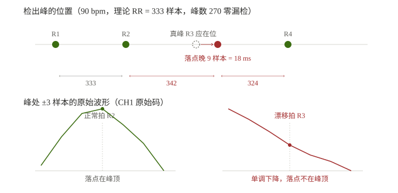

# T222 QRS 检测器定位缺陷：技术讨论稿

> **日期**：2026-11-10　**状态**：待外部评估
> **用途**：把问题、证据、方案与分歧点整理成独立可读的文本，交第三方评估。
> **不依赖任何内部上下文**——所需背景、术语、数据均在本稿内。
> **数据与工具**：`esp32/485tools/hrv_data/`、`_wide_*.txt`、`hrv_analyze.py`；
> 内部详细记录见 `docs/T221`（本稿是它的独立化版本）。

---

## 1 摘要

被测系统是一条自研 ECG 采集链（ADS1293 + STM32L476 → RS485 → ESP32-S3 → 屏显/SD 记录）。
R 峰检测在 ESP32 侧实现。

**问题**：用信号发生器（AECG100）在 6 个固定心率下各测 3 次，每次 180 s，
以「R 峰定位抖动的标准差 σ(e)」为指标，结果是 **4 个心率优秀、2 个心率不合格**：

| 设定心率 | σ(e) 三次（样本） | 均值 | 判定 |
|---|---|---|---|
| 60 bpm | 0.30 / 0.26 / 19.89\* | 0.28 | PASS |
| **90 bpm** | **2.66 / 3.06 / 2.43** | **2.72** | **FAIL** |
| **120 bpm** | **5.53 / 5.83 / 6.43** | **5.93** | **FAIL** |
| 150 bpm | 0.20 / 0.22 / 0.22 | 0.21 | PASS |
| 180 bpm | 0.32 / 0.32 / — | 0.32 | PASS |
| 210 bpm | 0.23 / 0.23 / 0.24 | 0.24 | PASS |

\* 60 bpm 第 3 轮出现 2 个假峰 + 1 个真峰漏检，判为偶发（另两轮 0.26/0.30）。

**量化极限**：500 Hz 采样下，整样本量化的理论下限是 σ = 1/√12 = **0.289 样本（0.58 ms）**。
PASS 的四个心率全部贴着这条线，说明检测器在这些工况下已无改进空间。

**为什么值得讨论**：90 / 120 bpm 恰好是**静息心率上沿与运动心率下沿**，是 HRV 分析最常用的区间。
4/6 PASS 不能算可用。

本稿把"已证实的事实""推断""方案选择"分开陈述，**§8 列出 5 个最需要外部意见的问题**。

---

## 2 系统与信号链

```
ADS1293 (AFE)
   │  853.33 Hz，24 bit ΔΣ，CH1 = 导联 I
   ▼
STM32L476
   │  FIR 重采样 853.33 → 500 Hz；组帧 25 样本/帧
   ▼
RS485 @115200（半双工，20 fps，单通道 59 B/帧）
   ▼
ESP32-S3
   ├─ UART1 解帧 → 环缓（5000 样本）
   ├─ R 峰检测（本次讨论对象）
   ├─ 屏显（LVGL，波形 + R 峰打点）
   └─ SD 记录（峰序号 / 峰处波形）
```

**测试条件**：信号发生器 AECG100 输出标准心电波形（固定心率、固定幅度），
电极侧为模拟器输出，无人体验证。

---

## 3 术语与判据

| 术语 | 定义 |
|---|---|
| **样本** | 一个 500 Hz 采样点 = 2 ms |
| **RR** | 相邻两个检出 R 峰的样本序号之差 |
| **T** | 理论 RR = 500 × 60 / 心率。例：90 bpm ⇒ T = 333.33 样本 |
| **σ(e)** | R 峰定位抖动的标准差，主用二阶差分法 `σ(e) = σ(Δ²RR)/√6`，用 `σ(RR)/√2` 交叉校验 |
| **PASS 判据** | σ(e) ≤ **0.5 样本（1 ms）**。该阈值由「对 RMSSD 的污染 < 5%」反推得到 |
| **落点** | 检测器最终输出的峰位置（样本序号） |

**为什么用二阶差分**：峰位置是 RR 的累加，若直接用"去趋势残差的标准差"会把随机游走误当噪声，
实测会虚高 8 倍（30.9 vs 真值 2.25 样本）。二阶差分对线性趋势免疫。

---

## 4 检测器结构（讨论重点）

`ecg_rpeak.c`，Pan-Tompkins 的变体，逐样本处理：

```
① 主基线   baseline += (x - baseline) × 0.002
② 低通     low  += (x - baseline - low) × 0.25
③ 高通     high += (low - high) × 0.05
④ 微分     4 抽头 (2,1,-1,-2)/8，滞后 3 样本
⑤ 平方
⑥ 积分     60 样本滑动窗（120 ms）
⑦ 峰判定   积分值超过自适应门限 noise + 0.25×(signal - noise)
⑧ 落点定位 locate_rpeak()：在 integrated_peak ± 40 样本窗口内，
           取「滤波信号绝对值」最大的点
⑨ 两道门   不应期 80 样本（160 ms）
           T 波判别 spacing < 360 且 slope < 上峰 slope × 0.5
```

### 4.1 关键代码（第 ⑧ 步）

```c
static int64_t locate_rpeak(const ecg_rpeak_t *rp, int64_t integrated_peak)
{
    const int64_t start = integrated_peak - 40;
    const int64_t end   = integrated_peak + 40;
    int64_t best_idx = integrated_peak;
    float   best_abs = -1.0f;

    for (int k = 0; k < rp->filt_n; k++) {
        const ecg_rp_hist_t *h = &rp->filt_hist[(first + k) % ECG_RP_FILT_HIST];
        if (h->index < start || h->index > end) continue;
        const float a = fabsf(h->value);          /* ← 注意：绝对值 */
        if (!found || a > best_abs) { best_abs = a; best_idx = h->index; }
    }
    return found ? best_idx : integrated_peak;
}
```

**两个特征值得注意**：
1. 在**滤波域**（②③ 之后的信号）找极值，不是原始样本域
2. 用 **`fabsf`** ⇒ 负向极值与正向同等对待

---

## 5 观测事实

### 5.1 偏离呈严格成对结构

90 bpm 的 RR 偏离理论值的序列（RR − 333）：

```
... +9×1, −8×1, 0×41, +9×1, −9×1, 0×9 ...
... +27×1, −27×1, 0×32 ...          ← 120 bpm 同构
```

`+Δ / −Δ` 紧邻出现 ⇒ **一次单拍落点漂移会产生两个异常间期**（漂移拍与其后一拍）。

### 5.2 峰数准确 —— 不是漏检

| 心率 | 峰数 / 跨度 | 反算心率 | 设定值 |
|---|---|---|---|
| 90 | 270 / 179.35 s | 90.4 bpm | 90 ✓ |
| 120 | 360 / 179.5 s | 120.3 bpm | 120 ✓ |

**每一拍都检到了，零漏检、零多检。** 所以 90/120 的问题是「落点偏了」，不是「少了一个」。

### 5.3 落点偏到 R 波下降支（90 bpm）

用「峰处 ±3 个原始样本」的记录（`rpeak wide`，一峰一行）：

```
正常拍（RR=333）：
  v = 9049 → 9556 → 10013 → 10101 → 9810 → 9455 → 8974     ← 尖峰
                              ↑峰顶

漂移拍（RR=342，落点晚 9 样本）：
  v = 7751 → 7153 → 6452 → 5658 → 5106 → 4750 → 4394       ← 单调下降，无局部极大
                              ↑落点
```



**判决**：漂移拍那 7 个点单调下降，**没有任何局部极大** ⇒ 落点不在 R 波峰顶。

### 5.4 60 bpm 偶发多检：两个假峰 + 一个真峰漏检

60 bpm 三轮里有一轮出现异常（181 峰，正常应为 180）。该段完整峰序列：

| 序号 | 与前一峰间隔 | 峰高（7 点最大） | 波形 | 判定 |
|---|---|---|---|---|
| 14 | 500 | 10462 | 9423→10462→9556 | 真 R |
| **15** | **449** | **−407** | **−407→−645→−640** | **假峰（负向）** |
| **16** | **471** | **710** | 530→710→670 | **假峰（P 波位置）** |
| 17 | 80 | 10497 | 9205→10497→9611 | 真 R |
| 18 | 500 | 10609 | 8599→10609→9990 | 真 R |

**时间账**：

```
#14 真 R 在 t=0
应有下一个真 R 在 t=500        ← 被漏检
#15 假峰   在 t=449            ← 真 R 前 51 样本，负向，落在基线以下
#16 假峰   在 t=920            ← 下一 R 前 80 样本，正向小隆起（P 波位置）
#17 真 R   在 t=1000           ← 在
```

⇒ 这 2 拍内应有 **3** 个峰，实有 **4** 个 ⇒ **净 +1 = 多检 2 − 漏检 1**

**幅度统计**：全轮峰高中位 10587、最大 10689，**仅这 2 个假峰 < 2000**：

| 假峰 | 峰高 | 占正常 R |
|---|---|---|
| #15 | −407 | **3.9%**（且负向） |
| #16 | 710 | **6.8%** |

---

## 6 已排除的解释（附反例）

| 假设 | 反例 | 结论 |
|---|---|---|
| 采样率不够 | 500 Hz 下量化极限 0.289，4 个心率已达 0.20~0.32 | ❌ |
| 高心率退化 | 210 bpm 最高，σ=0.24 反而接近最好 | ❌ |
| RR 为整数样本才准 | 120 bpm 的 RR=250.00（整数）却最差；180 bpm RR=166.67（分数）却好 | ❌ |
| 积分窗占比过大 | 180 bpm 占比最高（窗/RR = 36%）却好 | ❌ |
| 链路丢帧 | 上行坏帧率实测 **0.000%**（3668 帧零错），`crc_err`/`seq_gaps` 增量均为 0 | ❌ |
| 真 R 被 T 波判别拒绝 | 峰数对得上（270/270），说明没被拒绝 | ❌ |

---

## 7 根因推断（**中等强度，未直接取证**）

**三类失效同源：`locate_rpeak` 在滤波域选错了极值。**

| 场景 | 选到什么 | 现象 | 与正常 R 的幅度比 |
|---|---|---|---|
| 90 / 120 bpm | 下降支上的正向极值 | 落点偏 +9 / +27 样本，峰数不变 | 100% |
| 60 bpm #16 | P 波的小隆起 | 多检 1 个 | 6.8% |
| 60 bpm #15 | **基线下的负向极值** | 多检 1 个 + 真 R 漏检 | 3.9% |

**为什么滤波域会选错**：一阶低通（A=0.25）+ 一阶高通（A=0.05）在 QRS 下降支与 P 波附近
会产生过冲，其幅值可能超过峰顶；而 `fabsf` 使负向过冲同样参与竞争。

**为什么 ≠ 原始域的峰**：原始样本在漂移点上单调下降（§5.3），根本不是峰。

**推断的薄弱处**（诚实标注）：
- 未直接打印 `filt_hist` 在漂移拍附近的取值分布，无法证明"下降支极值确实大于峰顶极值"
- 未解释为什么只有 90/120 出现（60/150/180/210 几乎不出）
- 120 bpm 的 ±27 只从 RR 序列反推，**尚未做宽格式波形取证**

---

## 8 请重点评估的 5 个问题

> 这 5 条是本次最需要外部意见的地方，其余部分证据链相对完整。

**Q1. 判据本身是否合理？**
σ(e) ≤ 0.5 样本（1 ms）这个阈值由「RMSSD 污染 <5%」反推得到。
但 RMSSD 对**成对跳变**（+9/−9）极其敏感，而单个大跳变对 σ 的贡献又与样本数有关。
是否应该改用更直接的分位数指标（如 P99 绝对误差），或者"异常拍占比"？

**Q2. 根因推断是否成立？**
"滤波域极值 ≠ 原始域峰顶"是核心推断。从工程直觉看，一阶滤波器的过冲能否造成
9~27 个样本的落点偏移？还是更可能是积分窗中心（`integrated_peak`）本身漂移？
若后者，则修 `locate_rpeak` 无效，需要修积分窗。

**Q3. 修在哪一层？**

| 方案 | 做法 | 优点 | 缺点 |
|---|---|---|---|
| A | 改 `ecg_rpeak.c` 内部 | BPM / 打点 / 记录 / 分析四个消费方自动一致 | 动核心算法，有回归风险 |
| B | 在 pipeline 层后处理 | 不碰检测器 | BPM 与屏上打点仍用原始峰，需改数据流 |
| C | 混合 | — | `last_peak` / 候选池与校正结果不一致，可能引入新问题 |

**Q4. 幅度门限 30% 是否合适？**
实测假峰仅占正常 R 的 3.9% / 6.8%，取 30% 有充裕裕量。
但真实人体心电中，室性早搏、束支传导阻滞等形态幅度可能显著偏离；
此外基线漂移、电极接触变化也会改变幅度分布。30% 是否过于激进？
是否需要"相对本拍之前的若干拍"而非"全局长时平均"？

**Q5. 是否过度设计？**
现状 4/6 心率 PASS。若产品只关心 60~100 bpm 静息区间，则 90 bpm 需要修、120 bpm 未必。
是否存在"先接受 90/120 的现状、用后处理在 HRV 分析阶段剔除异常拍"的更轻方案？

---

## 9 建议方案（供评估，非结论）

### 9.1 修在检测器内部（对应 Q3 的方案 A）

**C2：幅度门限（在 `accept_peak` 之前）**

```c
/* 维护平均 R 幅度（原始样本域，用绝对值以兼容导联反接） */
const float amp = fabsf(raw_peak_value);
if (s_r_amp_n >= 5) {                    /* 冷启动保护：前 5 拍只学不判 */
    if (amp < 0.30f * s_avg_r_amp) {
        rp->noise_peak = 0.125f * prev_integ + 0.875f * rp->noise_peak;
        return;                          /* 判为 P 波 / 噪声，不产生峰 */
    }
}
s_avg_r_amp += 0.02f * (amp - s_avg_r_amp);
s_r_amp_n++;
```

**C3：落点纠正（在 `locate_rpeak` 返回之后）**

```c
/* 落点应为原始域 ±1 邻域的极大值；不是则就近搜索 */
if (!(raw[p] >= raw[p-1] && raw[p] >= raw[p+1])) {
    int64_t q = nearest_local_max(raw, p, W);
    if (q != NO_PEAK) p = q;             /* 找不到就保持原值：宁可偏，不可丢 */
}
```

**窗口 W 的取值**：

| 心率 | 实测漂移 | `RR/6` | 建议 W = min(30, max(9, RR/6)) |
|---|---|---|---|
| 90 | 9 | 55 | 30 ✓ |
| 120 | 27 | 41 | 30 ✓ |
| 210 | 0~1 | 23 | 23 ✓ |

封顶 30 是为了不跳到 T 波（T 在 R 后 75~125 样本）。

### 9.2 明确**不做**的事

| 不做 | 原因 |
|---|---|
| 调不应期（80 → 更大） | 漂移点与上一峰间距 342 样本（684 ms），远大于任何合理不应期；调它只会误杀 210 bpm 的真峰（RR=143 样本） |
| "不是局部极大就丢弃" | 会把整拍丢掉，峰数从 270 降到约 246，人为制造真漏检 |
| 只调 T 波判别的 `spacing` 阈值 | 峰数本来就对，问题不在"接受与否"，在"落点在哪" |

---

## 10 验证计划（可证伪）

| # | 动作 | 通过标准 | 若失败说明 |
|---|---|---|---|
| **V4** | 改码前：120 bpm 宽格式记录一次 | 拿到 ±27 的真实波形形态 | 若形态不是"单调下降" ⇒ 根因推断错 |
| **V1** | 改后测 90 bpm × 3 | σ ≤ 0.5 **且峰数仍为 270** | σ 不降 ⇒ 推断错；峰数变少 ⇒ 纠正逻辑丢拍 |
| **V2** | 改后测 120 bpm × 3 | σ ≤ 0.5 | 见 V4 |
| **V3** | 四个 PASS 心率各测 1 次 | 不劣化（≤0.35），峰数不变 | 门限误杀了真峰 |
| **V5** | 60 bpm 连测 6 次（偶发率约 1/3） | 峰数恒为 180，无峰高 < 2000 的峰 | 幅度门限未生效 |

---

## 11 已知局限

| # | 局限 |
|---|---|
| 1 | 数据全部来自 AECG100 固定心率，**无真实人体、无心律不齐、无形态变异** |
| 2 | 120 bpm 的 ±27 尚未做波形取证，根因推断对它的适用性是推测 |
| 3 | 未打印滤波域取值分布，"下降支极值 > 峰顶极值"未直接证实 |
| 4 | 60 bpm 偶发多检的触发条件未知（3 轮里 1 轮出现） |
| 5 | 幅度门限对低幅真搏（室早等）的影响未评估 |

---

## 12 附录：复现方式

```bash
# 1) 采集（ESP32 CLI，经 USB-CDC）
rpeak wide on          # 记录峰 + 峰处 ±3 原始样本
rpeak rec 180          # 180 s 自动落盘 → /sdcard/rpeak_hrv.txt
result-dump rpeak_hrv.txt   # 回传原文

# 2) 分析（PC）
py hrv_analyze.py --dump rpeak_hrv.txt --true-bpm 90
```

**数据文件**（仓库内）：
- `esp32/485tools/hrv_data/rpeak_hrv_{60,90,120,150,180,210}bpm_{1,2,3}.txt` — 18 轮紧凑格式
- `esp32/485tools/_wide_90bpm_v3.txt` — 90 bpm 宽格式（含 §5.3 的波形）
- `esp32/485tools/_wide_60bpm_{1,2,3}.txt` — 60 bpm 宽格式（含 §5.4 的多检段）
- `esp32/485tools/hrv_analyze.py` — σ(e) 计算（两法互校）

---

## 13 变更记录

| 版本 | 日期 | 变更 |
|---|---|---|
| v0.1 | 2026-11-10 | 首稿，供外部评估 |
