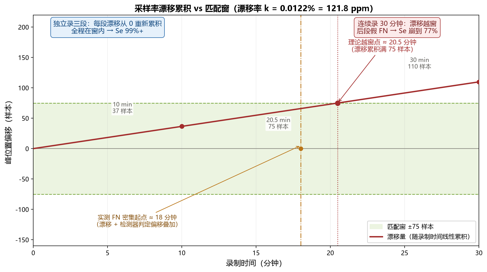

# MIT-BIH 硬件闭环对账：方法学与漂移分析（W2）

**日期**：2026-10-28
**上位**：`WinApp_MIT验证_工作梳理_20261027.md` §0（W2 判据）
**关联**：`AECG100播放MIT指南_20261027.md`（怎么播/录）、`Pan-Tompkins算法汇总_20261027.md`（算法事实底稿）
**工具**：`tools/w2_reconcile.py`（本文 §5）

---

## 0. 这份文档回答什么问题

一句话：**W2 硬件闭环对账「评的是位置，不是个数」——而「位置」会被采样率漂移悄悄破坏，必须先把漂移看穿、补掉，Se 才是有意义的数字。**

读这份文档，要能独立回答四个问题：

1. **测什么**：W2 要证明「模拟链路（D/A + 接线 + AFE + 重采样）不吃峰」，判据是 Se 差 ≤ 0.1 pp（§1）。
2. **怎么判**：逐峰位置匹配的机制是什么，为什么「个数对但位置错」会被判 0 分（§2）。
3. **坑在哪**：采样率漂移 0.0122% 是怎么把一条干净的录件「伪造」成 Se 崩塌的（§4）。
4. **怎么复现**：一条命令 `w2_reconcile.py` 跑完全流程（§5）。

---

## 1. 测试目的与判定目标

### 1.1 三层验证各回答什么

| 层 | 数据来源 | 回答的问题 | 要硬件 |
|---|---|---|---|
| **W1 数字基线** | `mit_bih/records/*_500.bin`（360→500 Hz 重采样、±5 mV、与固件同域） | C# 检测器本身在 MIT 上是什么水平 | 否 |
| **W2 硬件闭环** | AECG100 播 MIT → ADS1293 EVM → WinApp 录 `.bin` | 模拟链路 + 采集再吃掉多少 | 是 |
| **W3 真机闭环** | ESP32 板载检测器跑同一条数据 | 真机（板载 float 定点）再吃掉多少 | 是 |

**关键认知**：W1→W2 的差值才有意义。跳过 W1 直接做 W2，出问题分不清是算法还是接线。

### 1.2 W2 判据为什么是 Se 差 ≤ 0.1 pp

判据不是拍脑袋定的，有实测锚点：

- **AFE 数字注入已证明**：模拟前端（AFE 通道）只吃 ≤ 0.04 pp。
- **留 2.5 倍余量**给 D/A 重建、接线、电极接触、853→500 Hz 重采样。
- ⇒ 0.04 × 2.5 = **0.1 pp**。

所以 W2 判据 = **「整机峰序列 vs 数字基线，Se 差 ≤ 0.1 pp」**。**只看 Se，不看 +P**（原因见 §3.2）。

---

## 2. 评判标准：逐峰位置匹配机制（机制拆解）

### 2.1 不是数个数 —— 位置是硬约束

对账的核心不是「检出几个峰、标注几个峰」，而是**逐个真值峰在 ±150 ms 窗内找「最近的、还没被占用的」检测峰**。

`tools/mitbih_eval.py` 的 `score()` 核心循环：

```python
TOL = 75          # ±75 样本 @500 Hz = ±150 ms

for s, sym in truth:              # 遍历每一个真值搏动
    # 二分定位到 s - TOL，然后在 [s-TOL, s+TOL] 窗内找最近的未占用检测峰
    best, bestd = -1, TOL + 1
    j = lo
    while j < len(det) and det[j] <= s + TOL:   # 只在 ±75 样本窗内找
        if not used[j]:                         # 且该峰还没被别的真值占用
            d = abs(det[j] - s)
            if d < bestd: bestd, best = d, j    # 取窗口内最近的那个
        j += 1
    if best >= 0:
        used[best] = True; tp += 1    # 窗内找到 → TP
    else:
        fn_list.append((s, sym))      # 窗内没找到 → FN（漏检）
```

### 2.2 三层约束，缺一不可

1. **硬窗 ±75 样本（±150 ms）**：检测峰必须落在真值峰 `[s−75, s+75]` 区间内才算匹配。
2. **就近 + 互斥**：窗内多个候选峰时取**距离最近**的，且每个检测峰**只能被一个真值占用**（`used[j]` 标记，防止一个检测峰同时匹配两个相邻真值）。
3. **峰要一对一**：剩下的检测峰（没匹配上任何真值）全算 FP，剩下的真值（窗内没峰）全算 FN。

### 2.3 反例实证：个数一致但位置错 = 0 分

用真实 `score()` 跑出来的四个场景（真值 3 峰 @ `[1000,2000,3000]`）：

| 场景 | 检测峰位置 | TP | FP | FN | Se |
|---|---|---|---|---|---|
| A 个数对、位置全偏 500 样本 | `[1500,2500,3500]` | **0** | 3 | 3 | **0.0%** |
| B 个数对、位置也对 | `[1000,2000,3000]` | 3 | 0 | 0 | 100.0% |
| C 位置偏 74 样本（窗内极限） | `[1074,2074,3074]` | 3 | 0 | 0 | 100.0% |
| D 位置偏 76 样本（刚好越窗） | `[1076,2076,3076]` | **0** | 0 | 3 | **0.0%** |

**结论**：场景 A 正是「个数一致、位置不对」——结果 Se=0%，**不会被误判成满分**。因为匹配是逐个真值峰在窗内找最近峰，不是数个数。

### 2.4 为什么窗宽是 ±75 样本 @500 Hz

- **±150 ms 是行业标准容差**（Pan-Tompkins 1985 原文、AAMI EC57、PhysioNet bxb 都用这个量级）。
- 为什么不是 0：QRS 检测器输出的 R 峰位置，和 MIT 标注的 R 峰位置，本身就有几毫秒到几十毫秒的判定差异（不同算法对「R 峰顶点」定义、不同滤波器群延迟不同）。容差内算「这个峰认对了」。
- **窗很陡**：偏 74 样本算对（100%），偏 76 样本就算错（0%）。这正是漂移补偿为什么要命的直接原因（§4）。

### 2.5 单位陷阱：±75 样本只在 500 Hz 域 = ±150 ms

- `TOL = 75` 是**样本数**，写死在 `mitbih_eval.py`。它对应的时间窗取决于采样率：
  - @500 Hz：75 样本 × 2 ms = **±150 ms**（当前所有 W1/W2 对账都在此域）。
  - @853 Hz（ADS1293 code 域）：75 样本 × 1.17 ms ≈ **±88 ms**，不再是 ±150 ms。
- **纪律**：对账必须在 500 Hz LSB 域做，**别在 853 Hz code 域做**，否则匹配窗语义悄悄变了。

---

## 3. 三个指标各测什么（Se / +P / DER）

### 3.1 定义与分工

| 指标 | 公式 | 测什么 | 对位置偏差的敏感性 |
|---|---|---|---|
| **Se（灵敏度）** | TP/(TP+FN) | 真值峰有没有被「窗内认到」 | 直接：位置偏出窗 → FN → Se 掉 |
| **+P（阳性预测值）** | TP/(TP+FP) | 检出的峰有多少是「真」的 | 间接：多检峰位置偏，会顶替正确峰 |
| **DER（误检率）** | (FP+FN)/N | 总的错误比例 | 两者之和 |

**关键认知**：Se 只兜「漏检」这一侧，**不直接惩罚**「多检峰位置偏」。比如你多检了一个峰，恰好落在某个真值峰 ±75 窗内，它会优先「顶替」那个真值（就近匹配），原本正确的峰反而变成 FP。所以位置偏差的完整代价，是 **Se + +P + DER 三者合起来**才刻画清楚。

### 3.2 为什么 W2 只看 Se 不看 +P

- 脏记录（如 105 号多 PVC+噪声、108 号大段基线漂移+心律失常）里，检测器在噪声段大量误检，**+P 偏低是「记录本身难度」，不是「模拟链路引入」**。
- 证据：108 号的 W1 数字基线（纯数字、无模拟链路）+P 就只有 **80.58%**，W2 硬件闭环 +P 也在 76~90% 区间——两者同量级，说明 +P 低是 108 号自身的属性。
- W2 判据盯的是「模拟链路**吃不吃峰**」，即漏检（FN/Se）这一侧。多检（FP）是算法在脏信号上的固有行为，链路不该背锅。

---

## 4. 采样率漂移：怎么发现、怎么分析、怎么做实

> 这是本文分量最重的一节。漂移是 W2 长录件对账的**头号陷阱**——它会把一条完全干净的录件「伪造」成 Se 崩塌。

### 4.1 现象：18 分钟处 Se 崩塌

108 号连续录 30 分钟，未补偿直接对账：**Se 只有 77.65%**（FN 394 个）。一度误判成「模拟链路劣化」。

追查发现（108 号未补偿 FN 的时间分布实测）：
- 首个 FN 出现在 **15.5 分钟**（孤例），**18~20 分钟开始密集**（38 个），之后爆发式增长（22~24 min 90 个、24~26 min 117 个、26~28 min 108 个）。
- 「最近峰距离」全是 +86~+114 样本——峰不是没了，是**整体平移了**。
- 平移随录制时间**线性增长**。

> **「18 分钟」是两个不同时间点的统称，别混**：
> - **实测 FN 密集起点 ≈ 18 分钟**：漂移累积到 ~50 样本，加上检测器自身的判定偏移（几十样本），部分峰开始被推出 ±75 窗。
> - **理论越窗点 ≈ 20.5 分钟**：漂移率 0.0122% × 500 Hz = 0.061 样本/秒，累积满 75 样本需 1229 s ≈ 20.5 分钟，此后几乎全部峰越窗。
> 即 FN 从 18 分钟「开始」密集、到 20.5 分钟「全部」越窗，两者是同一根漂移线的两个阶段，不是两个独立现象。

### 4.2 第一次误判：峰位置贪心匹配测出 0.0088%（方向错）

最初用「峰位置贪心匹配」测漂移率，得出 0.0088%，**方向都搞反了**（105=+0.0119%、108=−0.0113%，符号相反）。

**根因**：105/108 是心律失常脏记录，峰匹配有歧义，贪心「最近峰」在心律失常段会错配，导致漂移符号被噪声翻转。

**教训**：测漂移率**不能用峰序列**（峰在心律失常段不可靠），要**直接测波形**。

### 4.3 正确方法：互相关直接测波形时间轴偏移

改用在段首、段尾各放一段 **5000 样本探针**，与基线做互相关，直接量波形的平移量：

```
段首偏移 lag0 = xcorr(基线[0:5000], 录件[0:5000])
段尾偏移 lag1 = xcorr(基线[段尾-5000:段尾], 录件[段尾-5000:段尾])
漂移率 k = (lag1 - lag0) / (段长 - 5000)
```

- 段首偏移 ≈ 0，段尾偏移 ≈ +36（10 分钟）/+109（30 分钟）。
- 线性拟合斜率 = **k = +0.01218%（121.8 ppm）**。

### 4.4 漂移率的符号含义（决定补偿方向）

**k > 0，录件峰比基线峰越来越「晚」**，即录件采样率偏**慢**（ADS1293 采样时钟 ppm 级偏差）。

⇒ 要把录件时间轴拉齐基线，补偿方向 = 峰号 `× (1 − k)`。

（历史教训：曾把方向搞反，`d + k·d` 变成 `d − k·d`，补偿后 Se 崩到 37.91%。）

### 4.5 三段独立录制判别实验：漂移是「累积」不是「时间点」

要分清「18 分钟崩塌」到底是**时间点效应**（AECG100 播到 18 分钟出问题）还是**漂移累积**（线性漂移随录制时间累积，到 18~20 分钟把峰推出窗），做了对照实验：

把 30 分钟记录切成三段（10:00 / 10:00 / 10:05.556），**独立录制**，每段漂移从 0 重新累积。

| 记录 | 独立录三段 Se | 连续录 30 min 未补偿 Se |
|---|---|---|
| 105 | 三段全 **99.44%** | 20~30 min 段 **14.79%** |
| 108 | 三段全 **99%+** | 30 min **77.65%** |

**结论坐实**：同样三段数据，独立录 Se 全 99%+，连续录就崩。⇒ **「18 分钟崩塌」是漂移线性累积越过 ±75 窗才产生的假 FN，不是时间点效应，也不是 AECG100 中途停播。**

### 4.6 补偿方法：× (1−k)，且只在越窗时补

- 漂移累积量 = `|k| × 段长`。
- **越窗才补**：累积量 > ±75 样本时，`det_c = [int(round(d × (1−k))) for d in det]`。
- **不越窗不补**：短段漂移量 < 窗时，逐峰取整误差反而制造边界 FN。

实测证据（108 全条 30 分钟，漂移 109.6 样本越窗）：

| 口径 | TP | FP | FN | Se | +P | DER |
|---|---|---|---|---|---|---|
| 未补偿 | 1369 | 782 | 394 | 77.65% | 63.64% | 66.70% |
| 补偿后 | 1746 | 405 | 17 | **99.04%** | 81.17% | 23.94% |

补偿一次，Se 从 77.65% 恢复到 99.04%（+21.38 pp）。

### 4.7 结论坐实：五条独立录件漂移率一致

| 数据源 | 漂移率 k | ppm |
|---|---|---|
| 105 全条 | 0.01218% | 121.8 |
| 108 全条 | 0.01214% | 121.4 |
| 105 seg03 | 0.01209% | 120.9 |
| 108 seg01 | 0.01254% | 125.4 |
| 108 seg02 | 0.01220% | 122.0 |
| 108 seg03 | 0.01209% | 120.9 |

五条独立录件全部落在 **120.9~125.4 ppm**，彼此差 < 4%。⇒ **漂移是 ADS1293 采样时钟的常数偏差**，不是 AECG100、不是随机抖动、不是接线。

**配套图**（漂移累积 vs 匹配窗，红线=漂移量线性增长，绿带=±75 样本匹配窗）：



图注：漂移量从 0 随录制时间线性增长（斜率 = 漂移率 k = 0.0122%）。10 分钟段漂移 ~36 样本，全程在绿带内（独立录三段 Se 99%+）；连续录 30 分钟漂移 ~109 样本，在理论越窗点 ≈20.5 分钟（漂移满 75 样本）后几乎全部峰被推出窗，实测 FN 从 ≈18 分钟开始密集（漂移 + 检测器判定偏移叠加），Se 崩到 77%。

---

## 5. 统一工具 w2_reconcile.py（可复现入口）

### 5.1 一条命令跑完全流程

```
解析 .bin → 互相关定界波形段 → 段首/尾测漂移率 k → rpeak_ref 检测器 → 逐峰对账
```

```bash
PY="C:/Users/luom/.workbuddy/binaries/python/envs/default/Scripts/python.exe"
"$PY" tools/w2_reconcile.py --bin recordings_winapp/ecg_xxx.bin --rec 108 \
    [--base-off N] [--base-len N] [--drift X] [--skip-det]
```

### 5.2 自动判断是否需要补偿

工具核心逻辑：**漂移累积量 `|k × 段长| > 匹配窗（75 样本）才补偿，否则不补。**

- 短段（10 min，漂移 36 样本）→ 自动不补，Se 直接可用。
- 长段（30 min，漂移 109 样本）→ 自动补 `×(1−k)`，Se 恢复。

### 5.3 参数表

| 参数 | 含义 | 默认 |
|---|---|---|
| `--bin` | 录件 `.bin` 路径 | 必填 |
| `--rec` | 记录号（如 108） | 必填 |
| `--base-off` | 基线段起点样本（分段录制用） | 0 |
| `--base-len` | 基线段长度样本 | 902800（全条） |
| `--drift` | 手动指定漂移率（跳过自动测量） | 自动测 |
| `--skip-det` | 跳过检测器（用已有 det 文件） | 否 |

---

## 6. 本次结论汇总（108 + 105 三段）

### 6.1 108 三段独立录制

| 段 | 基线段 | 漂移率 k | 段尾偏移 | Se | +P | DER |
|---|---|---|---|---|---|---|
| seg01 | 0~600 s | 0.01254% | 37 | **99.82%** | 78.46% | 27.58% |
| seg02 | 600~1200 s | 0.01220% | 36 | **99.47%** | 89.86% | 11.75% |
| seg03 | 1200~1805.556 s | 0.01209% | 36 | **99.21%** | 76.43% | 31.38% |

### 6.2 105 三段独立录制

| 段 | Se |
|---|---|
| seg01 | 99.44% |
| seg02 | 99.44% |
| seg03 | 99.44% |

### 6.3 三个结论

1. **漂移率稳定**：五条独立录件 120.9~125.4 ppm，指向 ADS1293 采样时钟常数偏差。
2. **W2 判据成立**：三段 Se 全 99%+，对照 W1 数字基线（105=99.61%、108=98.92%），模拟链路不吃峰。
3. **+P 偏低是记录本身脏**：108 W1 数字基线 +P 也才 80.58%，与 W2 同量级，非链路引入。

---

## 7. 遗留问题 / 边界

1. **漂移根源未追**：k=0.0122% 指向 ADS1293 采样时钟偏差，但**精确采样率未实测**（需高精度时钟/函数发生器标定）。用户指示「先不追」，作为独立低优先级课题。
2. **补偿是否写进 W2 判据口径（待拍板）**：漂移属于「重采样代价」还是「模拟链路代价」？当前做法是「越窗才补」，但判据口径里要不要明文写「长录件先补漂移再对账」，需拍板。
3. **`summary.csv` 是 W=55 旧基线**：对账用 `{rec}_det.txt`（exe 已 W=40），别拿 summary.csv 的聚合数当 W=40 基准。

---

## 附：关键事实速查

- 匹配窗：**±150 ms = ±75 样本 @500 Hz**（`mitbih_eval.py:TOL=75`）。
- 漂移率：**k ≈ 0.0122%（121.8 ppm）**，补偿 `×(1−k)`。
- W2 判据：**Se 差 ≤ 0.1 pp**（0.04 pp × 2.5 倍余量）。
- 越窗点：漂移累积满 75 样本 ≈ 20.5 分钟（30 分钟录件后段；实测 FN 从 ≈18 分钟开始密集）。
- 幅度标定：`.bin` 码反推 µV 只用 `×0.1526`（`ECG_LSB_OUT_UV`），不是 0.1122（后者是 853 Hz code 域）。
